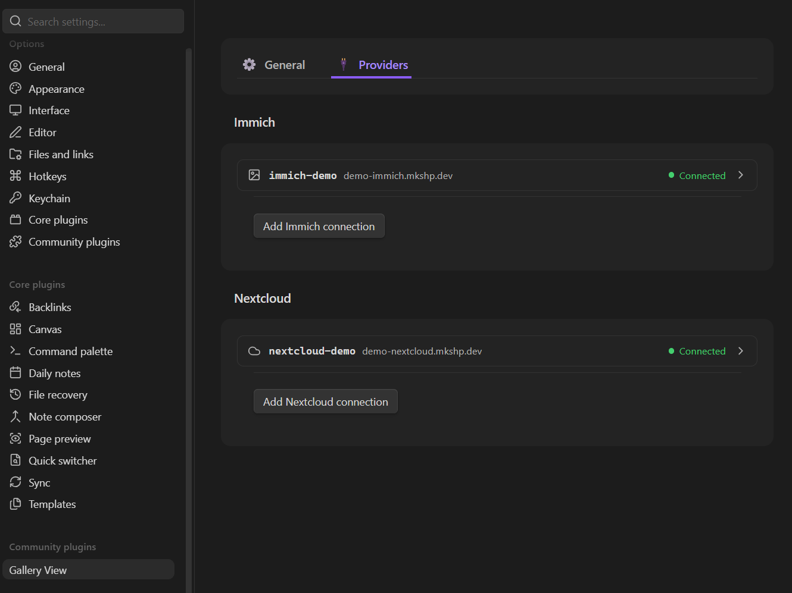

# Settings

You can configure plugin-wide behavior by opening **Settings → Gallery View**.

The settings panel is split into two tabs: **General** and **Providers**.

---

## General tab

The General tab controls core plugin behavior and remote image handling.

| Setting | Default | Description |
|---------|---------|-------------|
| Error messages | `Show` | When a gallery can't be shown, `Show` puts a one-line message (starting with ⚠️) in its place; `Hide` shows nothing. |
| Show gallery frame | `On` | Draws a border, background and padding around each gallery. Turn it off to place images directly in the note; thumbnail tiles keep their card look. A gallery can override this with `frame: true` or `frame: false` in its `view:` block. The embed view never has a frame. |
| Show captions | `On` | On: captions show under each image in every view, and take up space in the layout. Off: a caption appears over an image only while you hover over it or focus it with the keyboard (not on touch screens). A gallery can override this with `captions: true` or `captions: false` in its `view:` block. |
| Caption max lines | `1` | Controls the maximum number of text lines displayed for image captions before truncating with an ellipsis (configurable between 1 and 10). |
| Allow remote images | Off | Enable loading images from external URLs. Disabled by default to protect your privacy. If disabled, any `external` sources in your blocks will be skipped. |
| Remote load timeout (ms) | 30000 | How long the plugin waits for a remote image to load before giving up. Useful for slow network connections or slow remote servers. |
| Validate remote content type | Off | When enabled, the plugin performs a lightweight HEAD request to verify that a remote URL actually serves an image (e.g., `image/jpeg`) before attempting to load it. This reduces accidental loading of non-image resources, at the cost of one extra small network request per URL. |
| Detached gallery grace period (ms) | 30000 | How long to keep a gallery alive in memory after its container is removed from the view. This is useful for preventing galleries from reloading their images constantly if you frequently toggle between reading and editing modes. |
| Enable pagination by default | Off | Split every gallery into pages with Prev/Next buttons instead of one long scroll. A gallery can override this with `pagination` in its `view:` block (see [Gallery block syntax](./gallery-block-syntax.md#view)). |
| Images per page | `24` | Images per page when pagination is on. A gallery can override this with `itemsPerPage`. |
| Enable debug logging | Off | Write verbose debug logs (gallery rendering, refreshes, lifecycle events) to the developer console. Useful for troubleshooting. Errors and warnings are always logged. |

---

## Providers tab

The Providers tab manages authenticated connections to your **Immich** and **Nextcloud** servers. These connections are used by the `immich` and `nextcloud` source types to access your personal libraries and folders.

> [!NOTE]
> Public **shared links** (`immich-share` and `nextcloud-share` source types) do not require any configuration here — they work directly using public share URLs.

Each connection is a card. Its header shows the connection key, the server, and the result of the last test (**Not tested**, **Connected** or **Failed**; hover over **Failed** for the reason). Click the header to show or hide its fields. Problems such as a missing key, a key used twice, or a server URL without `https://` are listed under the header.

### Immich connections

1. Click **Add Immich connection**.
2. Fill in the fields:

| Field | Description |
|-------|-------------|
| **Connection key** | A short name you choose (e.g. `home`). Gallery blocks refer to it as `connection: home`. |
| **Server URL** | The address of your Immich server, e.g. `https://photos.example.com`. |
| **API key** | Create one in Immich under **Account settings → API keys**. Read access is enough. The key is hidden; use the eye button to show it. |

3. Click **Test connection**.

### Nextcloud connections

1. Click **Add Nextcloud connection**.
2. Fill in the fields:

| Field | Description |
|-------|-------------|
| **Connection key** | A short name you choose (e.g. `my-cloud`). Gallery blocks refer to it as `connection: my-cloud`. |
| **Server URL** | The address of your Nextcloud server, e.g. `https://cloud.example.com`. |
| **Username** | Your Nextcloud login name (shown in Nextcloud under **Personal settings**). An email address or display name won't work. |
| **App password** | Create one in Nextcloud under **Personal settings → Security → Devices & sessions**. Hidden; use the eye button to show it. |

3. Click **Test connection**.

Each card also shows the line to use in gallery blocks (`connection: <key>`), with a button to copy it. Changes are saved as you type, and galleries that use the connection reload when you leave a field.

### Removing a connection

Click **Remove**, then **Click again to remove** within a few seconds. This only deletes the saved connection; it doesn't affect your server or your notes.

> [!WARNING]
> If you remove a connection whose `key` is referenced in a gallery block, that block will show a "Connection not found" error until you restore the connection or update the block.
