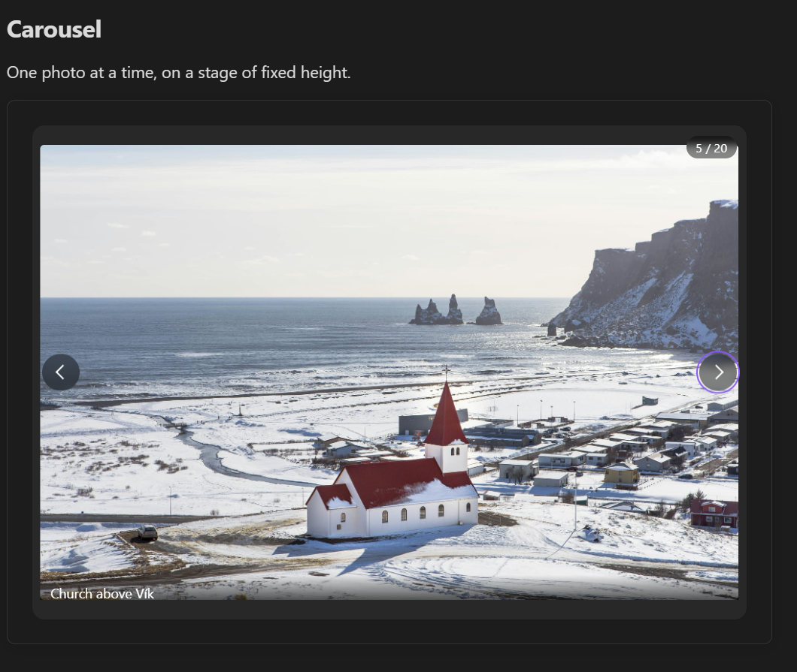

# Carousel view



A horizontally scrolling view with previous/next navigation controls.

````markdown
```obs-gallery
sources:
  - type: local
    path: Images/Screenshots
view:
  type: carousel
```
````

Move between slides with the arrow buttons, the dots under the slides, the **←** / **→** keys (with the carousel focused), or by swiping on a touch screen. Click a slide to open it in the [image viewer](./image-viewer.md).

The carousel always holds every image, so the `pagination` and `itemsPerPage` view options don't apply to it; if a carousel block sets them, a note under the gallery says they are ignored. `captions: false` moves the captions from under the slides to a hover overlay on the image.
