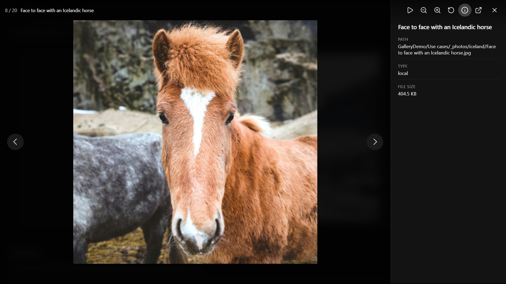

# Image viewer

Click an image in any view (or focus it and press **Enter** or **Space**) to open it full size in the image viewer. The viewer steps through every image in the gallery, including those on other pages when pagination is on, and wraps around at the ends.

The viewer fills the screen with the photo on a dark background. The top bar shows where you are (for example **3 / 24**) and the file name, and the image's caption, if it has one, appears under the photo. The bar and arrows fade away after a few seconds without moving the mouse, and come back as soon as you move it or press a key.

For Immich and Nextcloud galleries, the viewer first shows the small image the gallery already loaded, then switches to a sharper one as soon as it has downloaded: Immich's preview size (about 1440 pixels), or a 2048-pixel Nextcloud preview. The images either side are fetched in the background, so stepping through is quick.

## Controls

| Control | Action |
|---|---|
| The arrows on the sides, **←** / **→**, or a swipe on a touch screen | Previous / next image |
| **Play** / **Pause** | Start or pause a slideshow (4 seconds per image). Moving to another image by hand pauses it. |
| **Zoom out** / **Zoom in**, the mouse wheel over the image, or a pinch on a touch screen | Zoom out / in. On narrow screens the two buttons are hidden; pinch to zoom instead. |
| Double-click the image | Zoom in, or back to the whole image |
| Drag the image (one finger on a touch screen) | Move around a zoomed image |
| **Reset zoom** | Back to the whole image |
| **Details** (ⓘ) | Show or hide the details panel: name, path, source type, caption, and size when known |
| **Open or save image** | Open the image in a new tab, or save it, at the size the viewer shows |
| **Close** (✕), **Esc**, or a click on the dark area around the photo | Close the viewer |

Galleries with a single image have no arrows or slideshow button.

## Keyboard in the gallery

- **Thumbnail view:** **←** / **→** move between tiles; **Enter** or **Space** opens the focused one.
- **Masonry, justified and embed views:** **Tab** moves between images; **Enter** or **Space** opens one.
- **Carousel view:** with the carousel focused, **←** / **→** change the slide. You can also use the arrow buttons, the dots under the slides, or swipe on a touch screen.

## Captions

With captions on, they show under each image. With captions off, a caption appears over the bottom of an image only while you hover over it or focus it with the keyboard, and not at all on touch screens. Captions also appear in the image viewer's details (ℹ️). Where they come from:

| Source | Caption |
|---|---|
| `external` | The `caption` of a `{ url, caption }` entry, otherwise the file name |
| `immich`, `immich-share` | The photo's description in Immich, otherwise the file name |
| `local`, `nextcloud`, `nextcloud-share` | The file name |

Turn captions on or off, or change how many lines they may use, in [Settings](../settings.md#general-tab). A gallery can override the setting with `captions: true` or `captions: false` in its `view:` block.
