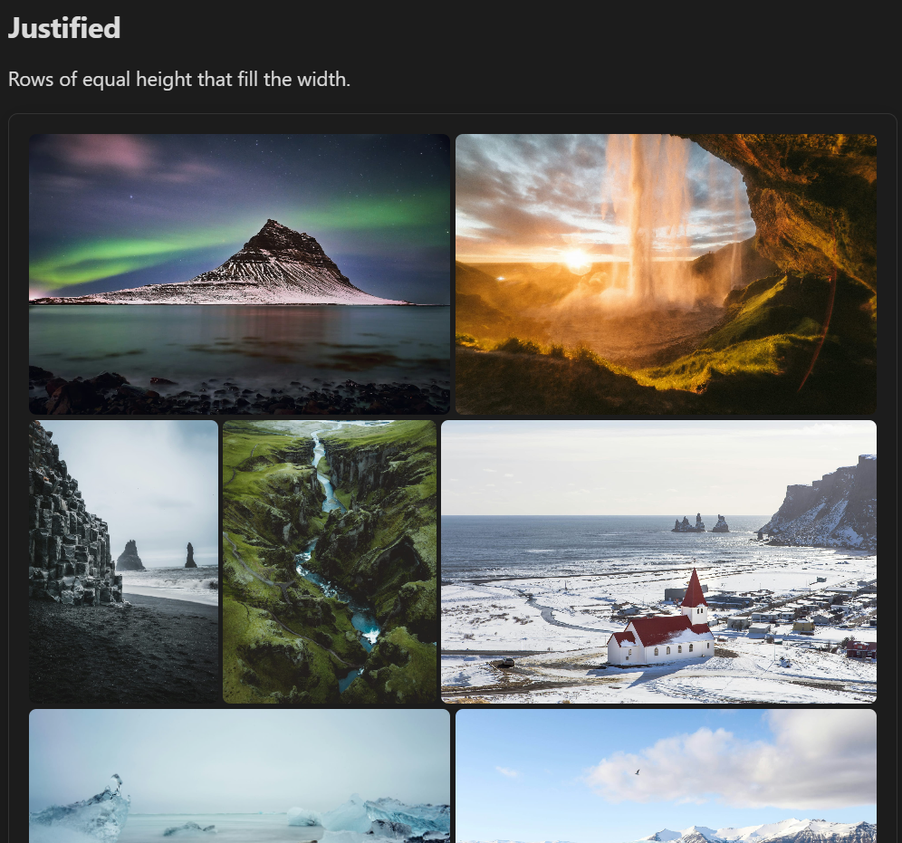

# Justified view



Rows of equal height that exactly fill the width of the note, with every image shown uncropped at its own width. This is the layout photo apps such as Immich, Google Photos and Flickr use for their timelines.

````markdown
```obs-gallery
sources:
  - type: immich-share
    url: https://immich.example.com/share/your-share-key
view:
  type: justified
```
````

How it lays out images:

- Each row is scaled so its images fill the width exactly, at a height close to the target row height.
- On a narrow screen the target row height is capped at 40% of the gallery's width, so a phone still shows two or three photos per row.
- The last row is not stretched. If it is short, its images keep the target height and the row stays left-aligned.
- A panorama too wide for a single row gets a row of its own.
- With captions on, each image has its caption underneath, and each row grows by that line; the row height is the height of the images. With captions off, a caption appears over an image only while you hover over it (not on touch screens). See **Settings → Gallery View → Show captions**.

For `immich`, `immich-share` and `nextcloud` sources the plugin fetches thumbnails rather than full-size images. For Immich sources it also knows each image's size before it downloads, so rows don't shift as images load. For other sources, rows below an image may reflow once it loads and its real size is known.

### Pagination

Add `pagination: true` (optionally with `itemsPerPage`) to page through large collections. See the [Masonry view](./masonry.md#pagination) page for the config keys — they work the same way here.

### Row height and spacing

Set them for one gallery in its `view:` block, in pixels:

````markdown
```obs-gallery
sources:
  - type: immich-share
    url: https://demo-immich.mkshp.dev/share/7XBAej6IyThZOS7izb78XcEJX7QhYwQBmxtHxaBz7TaaqiP5pxWyZQrN6TIvUGRhI9g
view:
  type: justified
  rowHeight: 280   # target row height (default 220)
  gap: 2           # space between images (default 4)
```
````

Add `captions: false` to show captions only on hover for this gallery, or `captions: true` to show them under the images.

### Customizing with CSS

To change the defaults for every gallery, set the same values as CSS variables in a [CSS snippet](https://help.obsidian.md/snippets):

```css
.gallery-justified-layout {
  --gallery-justified-row-height: 280px; /* target row height (default 220px) */
  --gallery-justified-gap: 2px;          /* space between images (default 4px) */
}
```
