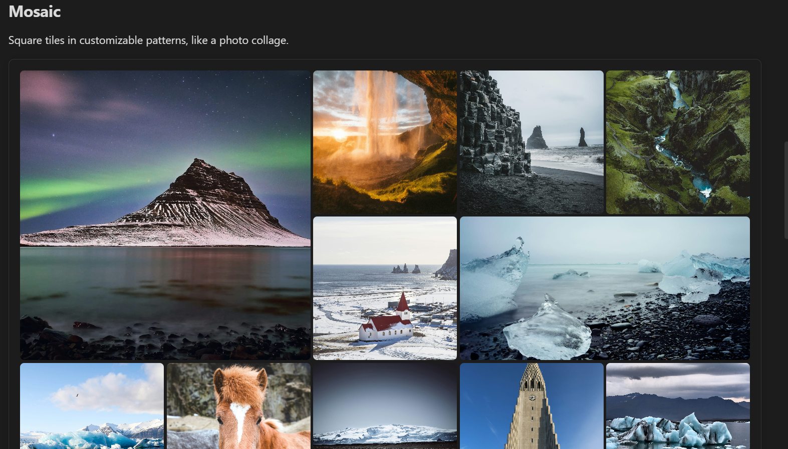

# Mosaic view



A grid of square tiles where a repeating pattern makes some of them large, the look of a photo collage or a "featured" grid. Images stay in the order their source gives them, and every image is shown: the pattern repeats as often as the gallery needs.

````markdown
```obs-gallery
sources:
  - type: local
    path: Photos/Iceland
view:
  type: mosaic
```
````

How it lays out images:

- The built-in pattern has three columns. It repeats every 12 images: a large tile on the left with two small ones beside it, a row of three, a large tile on the right, and another row of three.
- Images fill the tiles in order, so the first image gets the first large tile, and the image viewer's arrow keys go in the order you see.
- Tiles are cropped to fill their square (or larger) space, centred on the image. To show every image whole instead, use `fit: contain` (see [Fitting images](#fitting-images)). SVGs are always fitted inside their tile, so a logo or diagram isn't cut off.
- When the last repeat of the pattern isn't full, the gallery uses as much of the pattern as fills whole rows, and puts any remaining images in rows of small tiles. The last row may be short; no image is hidden and no placeholder is drawn. Blank cells in your own pattern (see below) are the only empty spaces.
- In a very narrow pane, where three columns would make tiles narrower than 90 pixels, the gallery switches to a two-column pattern: one large tile, then two rows of two. A phone keeps the three-column pattern.
- Captions sit over the bottom of each tile. With captions on, they always show there; with captions off, they appear only while you hover over a tile (not on touch screens).

For `immich`, `immich-share` and `nextcloud` sources, small tiles load thumbnails, and large tiles load the larger version the image viewer uses, so they stay sharp. That larger version is then already loaded when you open the image.

### Your own pattern

Draw your own pattern with the **Build custom mosaic** command (Command palette → "Gallery View: Build custom mosaic"):

1. Give the pattern a name, such as `featured`.
2. Set the number of columns (2–8) and rows (1–16).
3. With **Merge tiles** selected, drag across cells to merge them into one larger tile. Click a larger tile to split it back into single cells. Each tile shows a number: the order images fill the tiles in.
4. To leave space empty, pick **Leave blank** and click or drag across cells. Blank cells are hatched in the editor, and the gallery shows nothing there. Click a blank cell (with either tool) to use it again. **Reset** makes every cell a single tile again.
5. Check **How it repeats**, which shows the pattern twice, the way it continues down the gallery, then click **Save pattern**.

Then use the pattern by its name:

````markdown
```obs-gallery
sources:
  - type: local
    path: Photos/Iceland
view:
  type: mosaic
  pattern: featured
  gap: 6
```
````

In the **Insert gallery** builder, the mosaic's **Pattern** dropdown lists your saved patterns, and **New pattern…** opens the same editor.

Your patterns are listed under **Settings → Gallery View → Mosaic**, where you can edit, duplicate or delete them. Editing a pattern updates every gallery that uses it. Names match without regard to case, so `pattern: Featured` and `pattern: featured` are the same pattern.

Saved patterns belong to the vault they were made in, like the plugin's other settings. If a gallery names a pattern that isn't saved in the vault (it was renamed or deleted, or the note came from another vault), the gallery shows the built-in pattern and a note under it saying so. Save a pattern with that name to bring it back.

A pattern with more than two columns switches to the two-column pattern when its tiles would be narrower than 90 pixels, like the built-in one.

### Fitting images

Tile shapes come from the pattern, not from the images, so a tall photo in a wide tile (or a panorama in a square) can't fill it exactly. `fit` picks what happens:

- `crop` (default): the image fills the tile and its edges are cut off. This gives the cleanest collage.
- `contain`: the whole image is shown, and a blurred, enlarged copy of the same image fills the space around it. Good for screenshots, artwork and diagrams, where cutting off an edge loses something.

````markdown
```obs-gallery
sources:
  - type: local
    path: Screenshots
view:
  type: mosaic
  fit: contain
```
````

The blurred copy is made from the image that's already loaded, so `contain` downloads nothing extra. SVGs never get the blurred copy, since many have transparent backgrounds.

### Pagination

Add `pagination: true` (optionally with `itemsPerPage`) to page through large collections. See the [Masonry view](./masonry.md#pagination) page for the config keys — they work the same way here.

Each page holds whole repeats of the pattern, so every page shows the full pattern rather than ending part-way through it. `itemsPerPage` (or the **Images per page** setting) is rounded to the nearest multiple of the pattern's tiles, and a page always has at least one repeat. With the built-in pattern of 12 tiles:

| `itemsPerPage` | Images per page |
|---|---|
| 1 to 17 | 12 |
| 18 to 29 | 24 (the default 24 stays 24) |
| 30 to 41 | 36 |

Only the last page can have fewer images; they follow the pattern as far as it fills whole rows, then fill rows of small tiles.

### Spacing

Set the space between tiles for one gallery in its `view:` block, in pixels (default 4):

````markdown
```obs-gallery
sources:
  - type: local
    path: Photos/Iceland
view:
  type: mosaic
  gap: 0
```
````

### Customizing with CSS

To change the default for every gallery, set the same value as a CSS variable in a [CSS snippet](https://help.obsidian.md/snippets):

```css
.gallery-mosaic-layout {
  --gallery-mosaic-gap: 8px; /* space between tiles (default 4px) */
}
```
